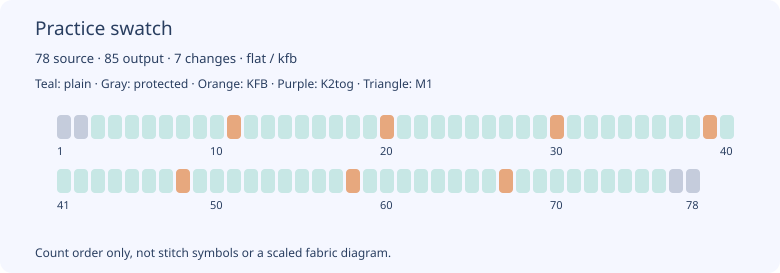

# Stitchspan

Every stitch accounted for.

**[Open Stitchspan](https://stitchspan.vercel.app)**

Stitchspan turns a one-row knitting increase or decrease into exact work instructions, a source-stitch map, and an independently checked count receipt.

- **Three count rules:** M1 between stitches, KFB into an existing stitch, and K2tog over a pair.
- **Flat or round:** protect a chosen number of stitches at each end of a flat row.
- **Explicit spacing:** plain-stitch gaps differ by at most one, with larger gaps interspersed.
- **Original positions:** see which source stitches each change consumes, and which output positions it produces.
- **Independent audit:** the instruction stream is walked again to check source coverage, output count, protected edges, distinct M1 gaps and gap balance.
- **Portable plans:** project JSON, complete text instructions, event CSV, full JSON receipt, HTML plan and SVG map.
- **Local processing:** no uploads, analytics, accounts, external runtime libraries or browser storage.

## Output preview



This is an actual generated source-stitch map, **not an application screenshot**. Native browser visual, assistive-technology, operating-system download and print checks are pending. A real workspace screenshot has not yet been captured.

## Run locally

Requires Node.js 22 or 24 and npm.

```sh
npm ci --ignore-scripts --no-audit --no-fund
npm test
npm run build
npm run dev
```

Open [http://127.0.0.1:4222](http://127.0.0.1:4222). Static assets are in `dist/`. No backend or environment variables are required. JSDOM is a pinned development-only test dependency. The build uses Node's standard library and normalizes asset line endings for reproducible Windows / Linux output.

## Make a plan

1. Enter the **starting** and **target** stitch counts.
2. Select a technique with the correct direction: M1 or KFB to increase, K2tog to decrease.
3. Choose a flat row or round. For a flat row, enter existing stitches to keep plain at the beginning and end of work order.
4. Choose **Make the count plan**. Review the count receipt, source map, complete instructions and exact change positions.
5. Save a JSON project to reopen your settings and notes. Text, HTML and SVG exports can sit beside your work.

“Plain” means work existing stitches without shaping, in the stitch called for by your own pattern. Technique labels describe arithmetic, not a technique tutorial. Choose the actual stitch, lean and fabric treatment from your pattern.

A dirty draft disables downloads until a successful rebuild. Invalid input keeps the previous view explicitly stale. Project imports validate and rebuild before replacing your work; later edits or reset cancel a pending import. Nothing is saved automatically. Closing or refreshing loses unsaved changes.

Switching to round sets both protected-edge counts to zero. Switching back to flat leaves them at zero until you change them.

## Count rules

| Technique | Consumes original stitches | Produces stitches | Net change |
| --- | --- | --- | --- |
| M1 | 0, at an internal source boundary | 1 | +1 |
| KFB | 1 | 2 | +1 |
| K2tog | 2 consecutive, nonoverlapping stitches | 1 | −1 |

All original stitches are numbered **once in work order**, starting at 1. These numbers never change after an increase or decrease. Output positions are numbered separately. A source map cell always represents an original stitch, not an output stitch.

For M1, a flat row uses distinct boundaries inside the working area, away from the protected edges. Every plain gap must have at least one original stitch. A round can insert after the final source stitch, at the seam before stitch 1. Adjacent insertions at the same boundary are not supported.

A no-change plan is allowed with any technique. Its instructions simply work all existing stitches, preserving chosen edges.

## Spacing policy

The working interior is `starting − protected start − protected end`. Each change's source consumption is subtracted first. Remaining plain stitches are shared over:

- `changes + 1` gaps for a flat row, including both ends of the working interior.
- `changes` gaps for a round, with the plan ending at its final shaping operation.

For plain count `P` and gap count `G`, gap `i`, indexed from zero, gets:

```text
floor((i + 1) × P / G) − floor(i × P / G)
```

This covers every plain stitch and keeps the largest and smallest gaps within one stitch. Protected edges are then added as separate plain instructions.

Flat end gaps have the **same weight** as interior gaps. This policy does not guarantee mirror symmetry, half-width edge spacing, equal physical distances, or an aesthetically optimal shaping layout. It does not stagger changes across multiple rows.

## Independent count audit

The verifier does not trust the generator's gap array or totals. It walks the instruction stream, recomputes source and output cursors, checks each operation's consumption, protects edge ranges, and rebuilds the actual gap counts.

A passed count audit means the arithmetic contract holds. It is not evidence of garment fit, correct gauge, fabric appearance, suitable stitch choice, motif alignment, ribbing / lace / cable compatibility, or a tested knitting pattern.

The map reads left to right in work order and is **not** a conventional knitting chart, stitch-symbol diagram, or scaled fabric. Full text and change-position exports provide the exact count alternative to color and hover labels.

## Exports

| Download | Contains |
| --- | --- |
| Save project | Validated input settings, title and notes |
| Text instructions | Every work step, source change positions, output ranges and count summary |
| Change CSV | Every change's technique, original source range or boundary, output range |
| Full JSON report | Project plus independently computed steps, events and count receipt |
| HTML plan | Full text, generated map and complete change-position table |
| Source map SVG | Every original stitch, protected ranges and shaping positions |

Table pagination does not limit exports. CSV contains only validated numeric counts and fixed technique labels; title and notes are omitted. Projects and full reports include notes, so review before sharing. No redaction or secret detection is performed.

## Limits

| Boundary | Limit / behavior |
| --- | --- |
| Starting stitches | Integer 1–1,000 |
| Target stitches | Integer 1–2,000, subject to operation and source limits |
| Changes | At most 250 |
| Protected edges | Integers 0–1,000; sum cannot exceed starting count |
| Round edges | Both zero |
| KFB capacity | At most one increase per unprotected source stitch |
| K2tog capacity | At most one decrease per two unprotected source stitches |
| M1 capacity | Flat: at most interior − 1; round: at most interior |
| Title / notes | 100 / 4,000 UTF-16 units |
| Project import | 40,000 bytes and 40,000 text units; strict versioned schema |
| Visible change table | 20 changes per page; exports contain all |
| Instruction stream | At most 503 work steps |

Inputs reject fractional, negative, signed, exponent-form and whitespace-padded count strings. Literal unpaired UTF-16 surrogates are rejected in text. No multirow planning, gauge conversion, pattern import, progress tracking, yarn estimation or physical knitting verification.

## Verification and examples

`npm test` runs **26 automated checks**. An independent token-consumption simulation covers **8,837 valid small plans and 2,503 rejected cases** across modes, techniques and edge settings. Additional checks cover count / gap conservation, incorrect instruction streams, repeated M1 boundaries, source-map cells, round trips, complete exports, escaping, stale plans, import races, real Blob payloads and simulated DOM interaction.

CI runs tests and builds on Windows and Linux with Node 22 and 24. JSDOM checks do not establish native rendering, screen-reader behavior or operating-system download behavior.

`npm run example` regenerates six artifacts in [examples](examples/). The invented practice example changes 78 stitches to 85 using seven KFB operations, with two protected stitches at each edge. Its plain gaps are `8, 8, 9, 8, 8, 9, 8, 9`. No third-party pattern is included.

## Deploy to Vercel

Import this repository into your Vercel account. Choose **Other**, Node **24.x**, build command `npm run build`, output directory `dist`, and an empty install command. Keep the repository root as the project root.

No environment variables, database, paid integrations, custom domain or dependency installation are required for the build. `vercel.json` supplies the static settings and no-referrer, content-type protection and CSP headers.

MIT licensed.
